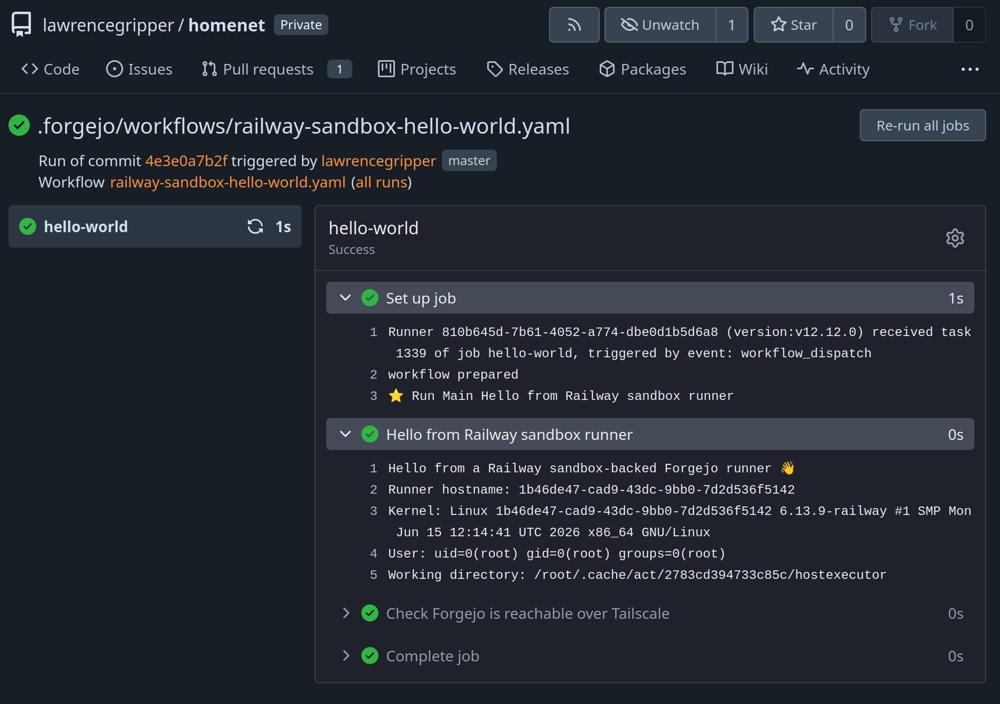

TLDR: Railway Sandboxes (due to fast cpu and bill by usage not allocation) are pretty great build machines for forgejo or GitHub Actions

## HomeLab CI Pains

I'm a HomeLab nerd and part of that is having copies of my data locally. 

For source code, and docker images, I use forgejo. It's has been pretty good. Using Fedora CoreOS and OCI Image based updates and TrueNAS/ZFS for storage, I get easy management and updating. 

Where I've seen a bit **more friction is getting ephemeral build machines**. Managing and keep up-to-date an image, with all the tooling is a faf. Making sure they're ephemeral, so one builds output can't hang around and impacting the next, is annoying. Ensuring they register with forgejo, when required, and spin down when not needed has been fiddly. Lastly, large builds tend to eat all the CPU and disk throughput impacting other stuff I'm running. 

None of these are insurmountable problems, but together they've made it hard to hit zero friction goal.

For example, on resources, I can set the VM to not have all the CPU and limited disk throughput but then builds go slow. For ephemeral, I can configure containers but then there is docker-in-docker to sort, bits like eBPF builds don't play nice. 

In short, as much as I love my homelab, it's not a great place for running builds. Honestly that's fine, the main goal for me is having a copy of my data.

## Using remote sandboxes for my forgejo builds

I've recently been working with Railway Sandboxes fast starting, customizable micro VMs (full disclosure I work at Railway). Felt like these might be a nice way to solve the problem. 

The nice thing is you don't pay for the allocated cores/memory. You pay for usage of mem and cpu. This is pretty killer for builds. 

The CPU bound bits go fast (new AMD CPUs) and, if you sit in a `sleep 500` or an IO bound network operation, then you don't pay for those idle cores. So will it blend? Can sandboxes work as my homelabs build agents?

Yeah! They do, by sticking together Tailscale, Deno, Forgejo's API and the Railway TS SDK I can get on-demand forgejo runners where I only pay for CPU/memory usage. 

A little service polls the forgejo API for waiting jobs, when it sees one it starts a forgejo runner in run-once mode and monitors it till completion. 

Added bonus, sandboxes `Templates`, which let you bake a verison with all the tooling you need, so I can have the same code periodically configure a template with all the updated tooling that I want on the build runner. As they're full VMs no more docker-in-docker faff and because they run one job then get torn down I get fully ephemeral builds. 

## What about GitHub Actions?

I have bits on GitHub too, could I wire that up?

Turns out it's nicer than forgejo as they have the [`actions/scaleset`](https://github.com/actions/scaleset) sdk which gives you information about how many runners need provisioning and avoid the polling dance. 

Taking a similar approach I wired that up to sandboxes and things worked 🥳

## Performance

... todo ...